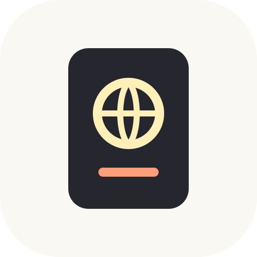

  

<h1 align="center">Passport</h1>

  <b>The campus marketplace where every item carries its own history.</b> 
  Find what you need, see what it is really worth, and hand it off safely, without a single awkward DM.

  <i>Needs, not listings</i> · <i>Fair prices you can check</i> · <i>Verified handoffs</i> · <i>One app, many campuses</i>

---

## Why Passport

Buying a used mini fridge from another student usually means scrolling a group chat, guessing what a fair price is, haggling over text, and meeting a stranger somewhere random. Passport replaces all of that with one clear next step at a time.

- **You say what you need.** Passport finds it, ranks it, and tells you why.
- **Every price is explained.** No mystery numbers: each one opens up to show how it was figured.
- **Every handoff is verified.** Two scans at a staffed safe zone, and the item's passport gets a stamp.

---

## How it works

| | Step | What happens |
|---|---|---|
| 1 | **Ask** | Type a need the way you would text a friend: *"Desk lamp under $30."* |
| 2 | **Compare** | Offers arrive ranked by how well they fit, how close they are, and how reliable the seller is. |
| 3 | **Claim** | Tap once to hold the item for 30 minutes while you settle the price. |
| 4 | **Price** | Take the ask, make an offer, or settle it with a Price Duel. |
| 5 | **Book** | Passport picks the fairest safe zone for both of you and a time that works. |
| 6 | **Hand off** | Meet, check the item, scan each other's code. Payment releases and the passport gets a stamp. |

---

## Features

### Needs and ranked offers
- **Plain-language needs.** Write it like a text; Passport turns it into a checklist of must-haves and nice-to-haves you can edit with a tap.
- **Odds of closing.** Every offer is scored on fit, walking distance, and the seller's track record, then sorted so the best real option is on top.
- **Ready now.** Offers you could close today are highlighted, so you never wonder where to start.
- **One-tap questions, never chat.** If a listing is missing something you require (the edition of a textbook, say), Passport asks the seller a single multiple-choice question for you.

### The item passport
- **Condition you can trust.** Each fact is labeled *Seller says* or *Verified*, so you always know what has been proven and what is only claimed.
- **Stamps.** Every completed handoff adds a stamp, a dual scan at a safe zone. Items with more stamps carry more trust, and a small price bonus.
- **Full history.** Flip the passport to see every owner, every price change, and every verified handoff, back to the day it was first listed.
- **Freshness.** Listings that have not been re-confirmed fade, then hide, so you never chase something that is already gone.

### Fair price, explained
- **A fair price for every item,** based on what the same thing actually sold for on your campus, adjusted for condition and history.
- **A clear verdict.** *"Asking $34, $8 under the fair price."*
- **Show the math, but only if you want it.** Every number has a folded *How we figured this out* panel with each symbol defined in plain words.

### Price history and timing
- **A year of campus prices** for the category, month by month.
- **A forecast** for the months ahead, built from the campus calendar: prices climb at move-in and fall at move-out.
- **Best time to buy.** The cheapest month last year, and the cheapest month predicted next.
- **Honest advice.** *Buy now*, *Fair today, but prices usually dip about 14% by December*, or *There is a better deal elsewhere*.

### Compared with elsewhere
- **Side by side with other marketplaces.** See what similar items cost on big online stores, auction sites, and local classifieds, including shipping and distance.
- **We tell you when to walk away.** If there is a meaningfully cheaper option off campus, Passport says so, along with what you give up (escrow and a safe zone).

### Price Duel
- **For when you both just want it settled.** The buyer proposes two prices, one if they win and one if the seller wins. Both sides must accept before anyone plays.
- **Twenty seconds of rock paper scissors,** with moves sealed until both are in.
- **The winner's price locks instantly,** and the duel is written into the item's passport.

### Safe, verified handoffs
- **Fair meeting points.** Passport picks the public, staffed safe zone where the longer of your two walks is shortest.
- **Escrow or pay in person,** chosen per campus. With escrow, money is held until the handoff and released on the second scan.
- **Rotating handoff codes.** Each code is tied to the trade and the person, lives 60 seconds, and refreshes every 30, so a screenshot is useless.
- **I'm at the spot.** Mark your arrival; if the other person never shows, you are covered.
- **Did it match the passport?** After the handoff the buyer confirms the condition, turning *Seller says* into *Verified*.

### Trust and reliability
- **Trust levels** that grow with every verified handoff, with diminishing credit for trading with the same person over and over.
- **Reliability** that counts how often a seller actually completes booked trades. New sellers start at a fair middle.
- **No-shows and late cancels count,** so flaky trading has a real cost.

### Explore map
- **A live map of finds around you,** pinned at safe zones, never at anyone's home.
- **Rarity tiers** from Common to Legendary, computed from how scarce an item is on campus and how far under the fair price it is. Sellers cannot set it.
- **Rare finds reach farther.** Common items show within a few minutes' walk; a Legendary deal shows from 25 minutes away.
- **A budget slider** and a nudge when a find matches one of your needs.

### Course Kit
- **Add your classes, get every required book** and its cheapest legitimate option: library reserve, free open edition, a used copy on campus, rental, or new.
- **See what the whole semester costs** and sort each book with one tap.
- **Done with a class?** Relist the book in one tap. Its passport and stamps come with it.

### Tickets and tutoring
- **Tickets** with a campus price cap over face value, proof of purchase, and escrow until the buyer confirms the transfer arrived.
- **Tutoring** with open hours, first-session discounts, in-person or video sessions, and ratings that only come from completed, paid sessions.

### Across campuses
- **Carrier day board.** Students driving between campuses carry small items for a tip.
- **Post a trip, shop their campus.** Planning a drive to another school? Your trip opens that campus's whole marketplace to you, and you meet the seller at one of their safe zones when you arrive.
- **Shared listings.** Sellers can make a listing visible to other campuses, with the real wait for the next trip shown up front.

### Built for many campuses
- **Add a campus with a single file:** its name, email domains, safe zones, residence halls, and walking times. No code.
- **Light, per-campus customization:** school colors, payment style (escrow or pay in person), ticket price caps, which features are on, and the campus resale calendar that drives price forecasts.
- **Strict separation.** Each campus only sees its own students, trades, and disputes, unless a student chooses to cross over with a trip or a seller opens a listing to everyone.
- **Campus admin tools** for reviewing disputes with the full dual-scan record.

---

## Try the demo

Seven campuses come pre-loaded: Alabama, UAB, Auburn, Georgia, Tennessee, Ole Miss, and LSU. Each has demo students you can sign in as with one tap.

A good first run, as **Maya** at Alabama:

1. Add a need: *"Desk lamp under $30."*
2. Open Sam's **Desk lamp, dimmable**, 6 minutes away, and look at its fair price, price history, and how it compares elsewhere.
3. Claim it, take the asking price, and book the suggested time at the Rec Center.
4. Open the handoff scan and use **Demo: both at the spot** to complete the trade on one device.
5. Confirm it matched the passport, and watch the stamp land.

Then try the **Explore** map (one Legendary, two Epic, two Rare, two Uncommon, and a Common within reach), a **Price Duel** on the mini fridge, or the **carrier board** to shop UAB on Maya's Friday trip.

The demo panel can fast-forward the clock, switch between escrow and pay in person, and reset everything back to the start.

---

## Photo credits

Listing photos are public domain (CC0). Full credits are in [`public/seed/photos/CREDITS.txt`](public/seed/photos/CREDITS.txt). Outside marketplace prices shown in the demo are sample data, not live.

---

<i>Built at Hackbama.</i>

